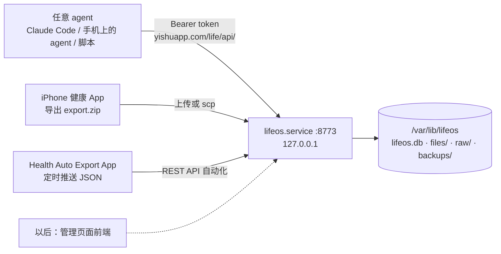
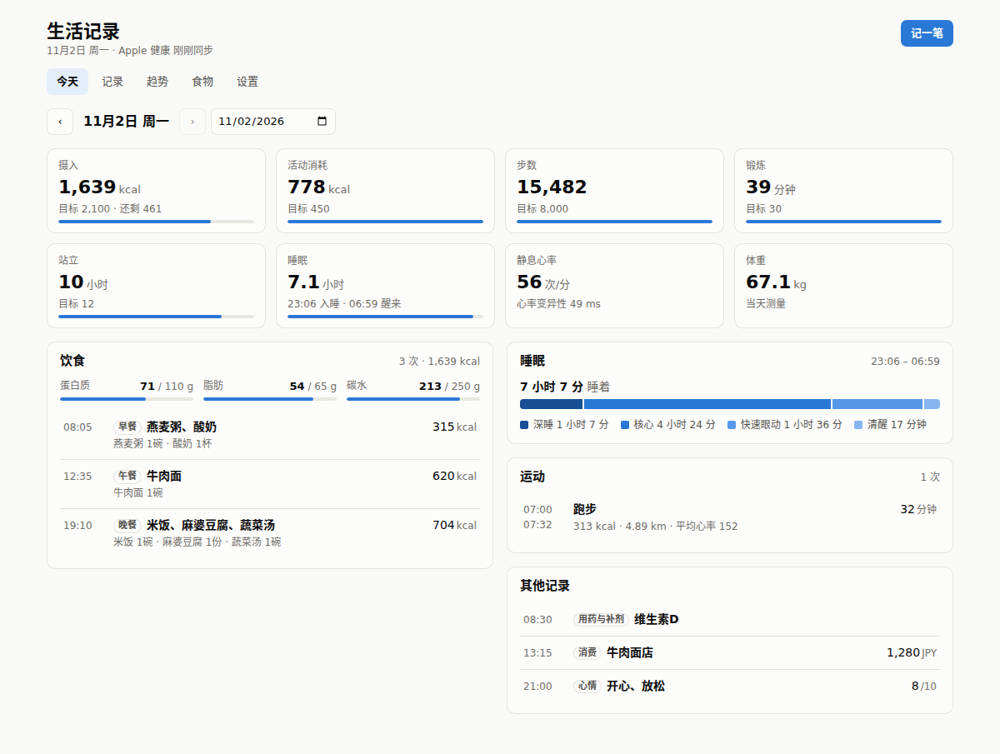
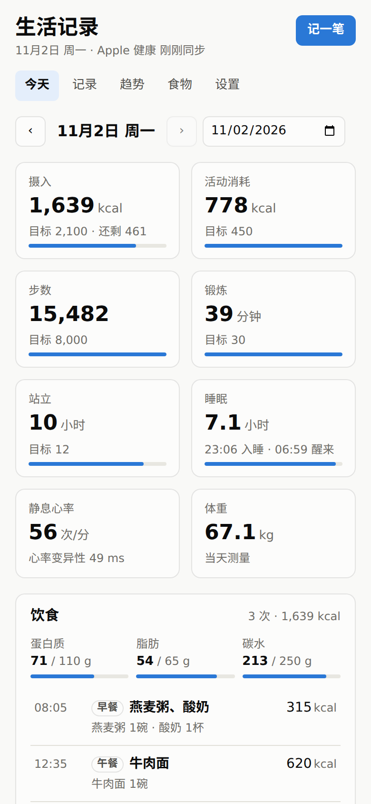
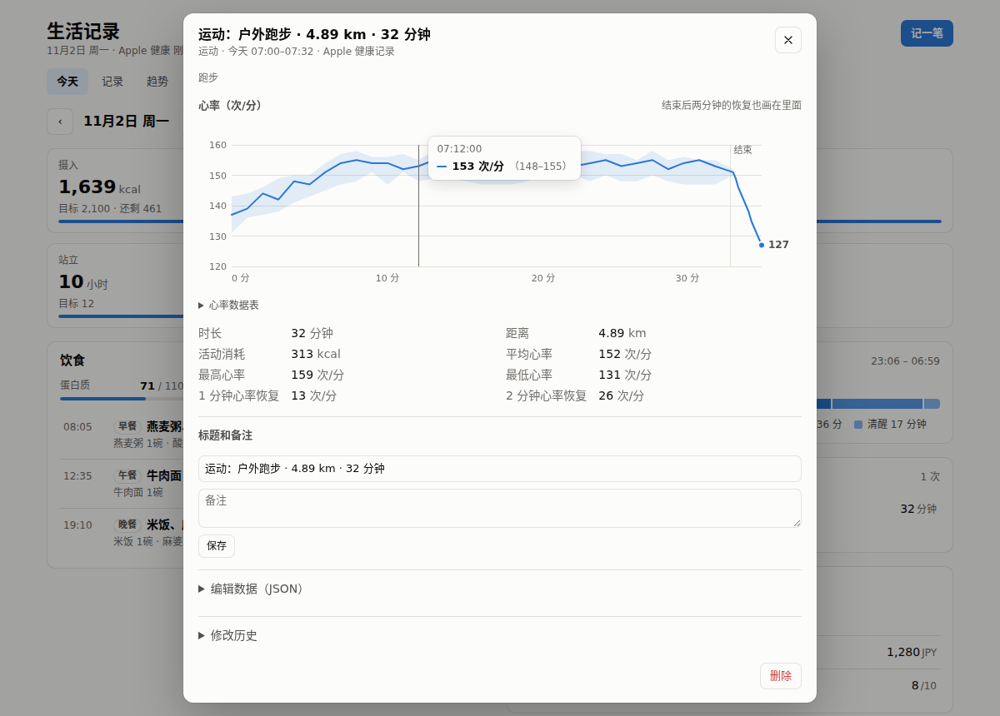
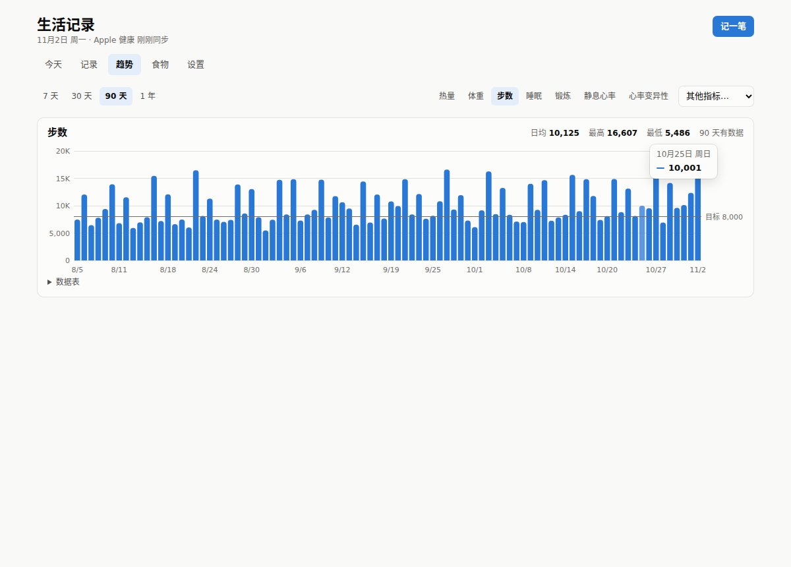

# lifeos

小主机上的个人记录后端：吃了什么、运动、苹果健康 / 苹果健身、睡眠、体重、心情、日记、用药、消费、抽烟……全部存在这台机器上的一个 SQLite 文件里，通过一套开放的 HTTP API 让任何 agent 读写。前端（个人管理页面）以后接在同一套 API 上。



## 截图

截图里的数据全是 [scripts/make_demo.py](scripts/make_demo.py) 生成的示例，不是真人的记录。



| 手机 | 运动详情（心率曲线和结束后的恢复） |
|---|---|
|  |  |



想先看看效果：

```bash
LIFEOS_HOME=/tmp/lifeos-demo .venv/bin/python scripts/make_demo.py
```

```bash
LIFEOS_HOME=/tmp/lifeos-demo .venv/bin/lifeos serve --port 8780
```

然后打开第一条命令最后打印的地址（`http://127.0.0.1:8780/#token=…`）。

## 设计要点

- **一份给 agent 看的说明书**：`GET /api/v1/manual`（同 `/llms.txt`），内容在 [manual.md](src/lifeos/manual.md)。另外有 `/api/v1/openapi.json` 和 `/api/v1/docs`。agent 先调用 `GET /api/v1/context`，一次拿到当前时间、时区、个人资料与目标、有哪些类别、今天已记录的内容和常吃的食物。
- **四种数据**
  - **记录（records）**：带时间的结构化事件。内置类别有饮食 `meal`、运动 `workout`、活动圆环 `activity_summary`、睡眠感受 `sleep`、心情 `mood`、日记 `journal`、用药 `medication`、身体状况 `symptom`、消费 `expense`、抽烟 `smoking`。agent 可以随时用 JSON Schema 新建类别，比如读书、护肤、学习时长。
  - **样本（samples）**：数值时间序列，比如步数、心率、体重、饮水、睡眠分期，苹果健康的数据基本都在这里。
  - **运动曲线（series）**：挂在某一条运动记录下面的数据，包括运动中和结束后两分钟的心率、每分钟的能量和距离、步数、骑行踏频和功率等，用 `GET /records/{id}/series` 读取。它们不计入全天统计，否则会和“健康指标”重复。心率恢复（结束后 1 分钟、2 分钟心率下降了多少）会直接算好，写进运动记录。
  - **食物库（foods）**：常吃的东西和它的营养数据。第二次吃同样的东西时，直接复用第一次的估算。
  - **个人资料（profile）**：身高、生日、目标、饮食禁忌、时区等。
- **“我今天吃饭了”怎么变成一条完整记录**：agent 按说明书给每样食物估算克数、热量和三大营养素，标上 `estimated` 和 `confidence`，一次写入。服务端负责算出合计、按时间补上餐次、生成标题，然后返回今天的累计和剩余额度，agent 再用一句话跟你确认。说错了就 PATCH 修改，记重了就删除（删除可以恢复）。
- **每次写入都能追溯**：每个 agent 用自己的 token，`/api/v1/changes` 记录了谁在什么时候改了什么，以及改动前后的内容。
- **完整本地化**：数据库、附件（餐食照片、运动路线 GPX）、所有导入的原始文件（`export.zip` 和每次推送的 JSON）都保存在 `/var/lib/lifeos`。将来解析器改进了，可以从原始文件重新导入。每晚 04:30（东京时间）用 SQLite 在线备份做一次快照，保留 30 份。
- **多设备去重**：iPhone 和 Apple Watch 往往会同时记录步数。按天统计时，每个小时只取记录较多的那个设备，不会把两边加起来。睡眠按每晚取一个设备，并归到醒来的那一天（18 点以后结束的睡眠算到第二天早上，所以半夜前睡着的那一段也归在同一晚）。导出文件和 Health Auto Export 覆盖同一天时，是同一份数据来了两次：只算当天总数较大的那一份，另一份只补它缺的小时。同一次运动不管来自导出文件还是自动推送，都只保留一条记录。重复导入不会产生重复数据，你给运动记录补充的 RPE 或备注也不会被覆盖。

## 网页

`https://yishuapp.com/life/`，风格和小主机状态页、作业助手一致，同样支持深色模式和手机。

- **今天**：最上面是抽烟卡片和今日热量卡片（都见下文）；步数、锻炼、站立、睡眠、静息心率、体重；三大营养素进度；每顿饭、睡眠阶段、运动和其他记录。可以往前翻日期。
- **记录**：按类别筛选、搜索所有记录。点开一条可以看明细：饮食的每样食物和营养，运动的心率曲线（含结束后两分钟的恢复）。还能改标题和备注、直接编辑数据、删除或恢复，以及查看修改历史（谁、什么时候改的）。
- **趋势**：7 天 / 30 天 / 90 天 / 1 年，可以看热量的摄入和消耗、体重、步数、睡眠、锻炼、静息心率、心率变异性、每天抽烟根数，以及其他任何有数据的指标；附带数据表和每日概览。
- **食物**：管理食物库。agent 记录同样的食物时会直接用这里的营养数据。
- **设置**：个人资料与每日目标（包括每天抽烟上限）、给 agent 发 token 和吊销 token、上传健康 App 的导出文件、导出全部数据、最近变更。
- **记一笔**：手动补一条饮食、体重、饮水、抽烟、心情或日记。

网页受 Cloudflare Access 保护，只有你本人能打开。它的接口走 `/life/web/api/v1`，同样受 Access 保护，所以不需要 token；写操作还会检查请求是否来自 `https://yishuapp.com`。给 agent 用的 `/life/api/v1` 照旧靠 token。在小主机本机打开可以用 `http://127.0.0.1:8773/#token=<token>`。

## 今日热量

一根收支条：吃进去往右加，静息和活动消耗往左扣，中间是维持体重。

- **目标线** = 设置里的每日热量目标 − 过去 30 天平均一天的消耗。平常活动量的一天，吃到目标正好落在线上；走得多，位置往左挪，就能多吃一点。
- **现在**是到这一刻的收支，随 Apple 健康的同步往下掉；提前记下的晚饭到点了才算进“现在”。**今晚**是之后不再吃也不再动的话到 24 点会落在哪：提前记下的饭算在里面，静息按过去 7 天的日平均补满（这 7 天没有数据就用 30 天的），活动不预估。
- 超过目标线时，下面一行写还要走多久、约多少步才能回到线上，按你最近 30 次步行的速度算；没超时写还能再吃多少。
- **昨天**自己吃的和消耗的，离它的目标线差多少，带进今天；昨天从前一天带进来的不算，所以只带一天、不往前累加。看以前的日子时，结论会注明其中有多少是前一天带进来的。
- 点开“一天的变化”能看到一天里的收支曲线：吃饭一下跳上去，静息和活动一点点扣下来。
- 没记饮食的日子显示“没记”，不参与计算，也不带进第二天。饮食记不全时，条会显得比实际减得多。
- agent 从 `GET /summary/day` 的 `energy` 读到同样的数，可以回答“今天还能吃多少”“吃多了要走多久”。

## 抽烟记录

每抽一根就是一条 `smoking` 记录，`data.count` 是根数；一天抽了多少就是当天所有记录的 `count` 相加。

- **自己按一下**：“今天”页最上面的卡片显示今天几根、上一根是几点、昨天和前 7 天的日均，点 **+1 根** 记一根（数字马上变），点 **−1** 撤销最近一根。下面一排是每一根的时间，点开可以补场景、备注或删除。设了每天上限，会多一条进度条，超出时变色。补记以前的用“记一笔”→“抽烟”，可以选时间、填根数。
- **AI 读写**：agent 用同一套 API。“抽了一根”就写一条 `{"category": "smoking", "data": {"count": 1}}`；“今天一共抽了 10 根”会先读 `GET /summary/day` 里的 `smoking.cigarettes`，只补差额，不会和你按的重复；问“这周抽了多少”读 `GET /summary/days` 每天的 `cigarettes`。说明书和 skill 里都写了，也要求 agent 只记录、不说教。
- 从第一次记录那天起，没有记录的日子按 0 根算（一根没抽）；在那之前算没有数据。

**不打开网页，用 iPhone 快捷指令按一下**（可选）：

1. 网页“设置”→“接入的 agent”，生成一个 token，名字比如 `iphone-shortcut`，权限选“读写”。
2. “快捷指令”App 新建一个快捷指令，加一个“获取 URL 的内容”：URL 填 `https://yishuapp.com/life/api/v1/records`，方法 POST，头部加 `Authorization`，值是 `Bearer ` 加 token；请求体选 JSON，加三个字段：`category` 文本 `smoking`，`source` 文本 `manual`，`data` 词典，里面 `count` 数字 `1`。
3. 想看到“今天第几根”，再加一个“获取 URL 的内容”请求 `https://yishuapp.com/life/api/v1/summary/day`（同样的头部），用“获取词典值”取 `smoking`，再取 `cigarettes`，最后“显示通知”。
4. 把它放到主屏幕、锁屏小组件、背面轻点或操作按钮上。

## 安装（需要你执行一次）

代码和虚拟环境已经在 `/opt/lifeos`。安装 systemd 服务这一步需要你本人确认：

```bash
cp /opt/lifeos/deploy/lifeos.service /opt/lifeos/deploy/lifeos-backup.service /opt/lifeos/deploy/lifeos-backup.timer /etc/systemd/system/ && ln -sf /opt/lifeos/.venv/bin/lifeos /usr/local/bin/lifeos && systemctl daemon-reload && systemctl enable --now lifeos.service lifeos-backup.timer
```

```bash
install -d -m 700 /etc/lifeos && (umask 077; lifeos token create mini-pc > /etc/lifeos/agent.token) && lifeos api GET whoami
```

第二条命令生成小主机自己用的 token，`lifeos api` 命令会读它。

## 给 agent 用的 skill

[skills/lifeos/SKILL.md](skills/lifeos/SKILL.md) 是写给所有 agent 的使用说明，不绑定某一个工具。一个 skill 就是一个文件夹，里面放一个 `SKILL.md`。文件开头的 `description` 写明什么时候该用：你提到吃饭、运动、体重、睡眠、心情，或者问起自己的数据时。正文写怎么连接、先调哪个接口、怎么估算一顿饭、怎么改错，以及记完之后怎么跟你确认。支持 skill 的 agent 平时只读 `description`，碰到相关话题才加载正文。

接入一个新 agent：

1. 先给它发一个 token：`lifeos token create <agent名>`。每个 agent 用自己的 token，写入记录时就能看出是谁写的，不想要了也可以单独吊销。
2. 告诉它地址和 token：环境变量 `LIFEOS_URL=https://yishuapp.com/life/api/v1` 和 `LIFEOS_TOKEN=<token>`。地址一定要写到 `/api/v1`：`/life` 本身在 Cloudflare Access 后面，agent 打开会卡在登录页。如果平台不能设环境变量，就写进你上传的那份 skill 副本里；但不要把 token 提交进这个公开仓库。
3. 把 skill 交给它：
   - 支持 skills 文件夹的 agent：把整个 `skills/lifeos` 文件夹放进它的 skills 目录。
   - Claude 网页版或 App：把这个文件夹打成 zip，在设置的 Skills 里上传。它运行 skill 的沙盒默认可能不能联网，需要允许访问 `yishuapp.com`。
   - 不支持 skill 的 agent：把 `SKILL.md` 的正文贴进它的自定义指令。也可以直接让它读说明书 `https://yishuapp.com/life/api/v1/manual`。能导入 OpenAPI 的平台（比如自定义 GPT 的 Actions），导入 `https://yishuapp.com/life/api/v1/openapi.json`，认证方式选 Bearer。

## 日常命令

| 命令 | 作用 |
|---|---|
| `lifeos token create <agent名> [--scope read\|write\|admin]` | 给一个 agent 发 token，只显示一次 |
| `lifeos token list` / `lifeos token revoke <名字>` | 查看 / 吊销 token |
| `lifeos api GET context` | 以 agent 身份调用 API，token 读自 `/etc/lifeos/agent.token` |
| `lifeos receive` | 打开 LocalSend 等手机发导出文件，确认后接收并导入（见下文） |
| `lifeos import apple-health ~/export.zip` | 导入已经在小主机上的苹果健康导出 |
| `lifeos status` | 看看存了多少东西 |
| `lifeos backup` | 立即做一次快照 |

## 苹果健康 / 苹果健身

**每天自动同步**：iPhone 上的 Health Auto Export App 建两个 REST API 自动化，一个“健康指标”，一个“运动”。
- 地址填 `https://yishuapp.com/life/api/v1/imports/health-auto-export`，Header 加 `Authorization: Bearer <token>`，格式选 JSON。
- 健康指标的聚合方式选“小时”，或者关闭 Summarize。按天汇总的数据和逐条的原始数据如果覆盖同一天，会重复计算。
- 运动选 Version 2，并打开 Include Workout Metrics。每次运动的心率曲线、心率恢复、每分钟的能量和距离都会挂在那条运动记录下面。

### 导入以前的历史

有三种办法，同样的数据导入两次也不会重复：

1. **“健康”App 导出，再用 LocalSend 发到小主机（推荐）**。这是苹果的原始完整数据，包括每个数据点、每次运动的完整统计、活动圆环和路线。
   1. iPhone：打开“健康”，点头像，选“导出所有健康数据”，选“存储到文件”。数据多时要几分钟，期间保持屏幕常亮，停在“健康”App 里。
   2. 小主机：运行 `lifeos receive --alias 小主机`。
   3. iPhone：打开 LocalSend，选“发送”→“文件”→ `导出.zip`，再选“小主机”。
   4. 小主机终端里会列出发送方和文件，输入 `y` 才接收。收完会自动识别文件类型，原件存进 `/var/lib/lifeos/raw/`，然后导入。
2. **Health Auto Export 手动上传**。在上面两个自动化里各点一次“导出现有数据 / Manual Upload”，日期从最早选到今天。数据会分批推到 lifeos，不用传文件。
3. **Health Auto Export 的 CSV 导出**（一个装着很多 CSV 的 zip）。同样用 `lifeos receive` 接收，或者用 `lifeos import health-auto-export-csv <zip>` 导入。只会导入里面的用药记录，因为苹果的导出没有这部分。其余数据请用前两种办法。

`lifeos receive` 需要 LocalSend 的命令行版。小主机没有桌面，用不了图形版。在 [LocalSend 的发布页](https://github.com/localsend/localsend/releases) 下载 `LocalSend-CLI-<版本>-linux-x86-64.tar.gz`，解压后把 `localsend-cli` 放到 `/usr/local/bin`。它只在 `lifeos receive` 运行期间监听局域网（端口 53317），收到一次就退出，平时不开着。

`lifeos receive` 的常用参数：

| 参数 | 作用 |
|---|---|
| `--alias 小主机` | 手机上显示的设备名，默认是主机名 |
| `--from <手机名>` | 没人守在终端时用：只自动接收这台设备发来的导出类文件（zip、xml、json、csv），其他请求一律拒绝。手机名就是 LocalSend 里显示的设备名 |
| `--no-import` | 只收文件、存进原件目录，不导入 |
| `--timeout 60` | 最多等几分钟 |

如果手机不在家，手机开着 Tailscale 也能发：在 LocalSend 里手动输入小主机的 Tailscale 地址。

1.4 GB 左右的导出文件，传输只要几秒，导入大约一分钟。导入后会多出一个约 700 MB 的数据库，原件另外保留。Cloudflare 免费版限制单个请求最大 100 MB，所以大文件不要从网页上传，用 LocalSend 或 scp。

## 公网入口：yishuapp.com/life/

服务只监听 127.0.0.1，由 Cloudflare Tunnel 转发进来。`lifeos.service` 设置了 `LIFEOS_PREFIX=/life`，所以同一套接口在本机的 `/` 和 `/life` 两个路径下都能访问。agent 需要的东西都在 `/life/api/` 下面，包括 API、说明书 `/life/api/v1/manual` 和 OpenAPI。

Cloudflare Zero Trust 里的配置（2026-11-02 已配好）：

1. **Tunnel 路由**：Public Hostname 新增一条，域名 `yishuapp.com`，路径 `^/life`（路径是正则，加 `^/` 才不会误配到其他含 life 的地址），服务 `http://127.0.0.1:8773`。这条排在 `^/classroom` 之后、指向整个域名的那条之前。
2. **Access 放行 API**：新建 self-hosted 应用 “Yishu life API”，地址 `yishuapp.com/life/api`，策略动作 **Bypass**、Include 选 Everyone。lifeos 自己会校验每个 agent 的 token，没有 token 一律返回 401。`/life/` 下除 `/life/api` 以外的路径（包括以后的前端）仍然受原来的 Access 保护，只有你本人能登录。

所以给 agent 的地址是 **`https://yishuapp.com/life/api/v1`**，不登录就能访问，它会列出说明书和 OpenAPI 的链接。另一种做法是把 `/life` 全部留在 Access 后面，给每个 agent 发 Cloudflare Service Token。但很多 agent 只能填一个认证头，这样就连不上了。

## 开发

```bash
cd /opt/lifeos && .venv/bin/pytest -q && .venv/bin/ruff check src tests
```

## 代码结构

[app.py](src/lifeos/app.py) 是 HTTP 层；[records.py](src/lifeos/records.py)、[samples.py](src/lifeos/samples.py)、[foods.py](src/lifeos/foods.py) 和 [profile.py](src/lifeos/profile.py) 是各类数据；[categories.py](src/lifeos/categories.py) 是内置类别、schema 和饮食合计；[summary.py](src/lifeos/summary.py) 生成每日汇总；[importers/](src/lifeos/importers/) 是苹果健康和 Health Auto Export 的导入；[intake.py](src/lifeos/intake.py) 识别导出文件并存档，[receive.py](src/lifeos/receive.py) 驱动 LocalSend 接收；[db.py](src/lifeos/db.py) 是表结构。

## 许可证

[Apache License 2.0](LICENSE)
