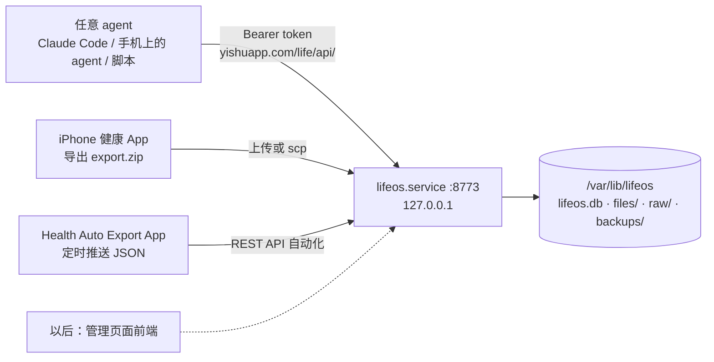

# lifeos

小主机上的个人记录后端：吃了什么、运动、苹果健康 / 苹果健身、睡眠、体重、心情、日记、用药、消费……全部存在这台机器上的一个 SQLite 文件里，通过一套开放的 HTTP API 让任何 agent 读写。前端（个人管理页面）以后接在同一套 API 上。



## 设计要点

- **一份给 agent 看的说明书**：`GET /api/v1/manual`（同 `/llms.txt`），内容在 [manual.md](src/lifeos/manual.md)。另外有 `/api/v1/openapi.json` 和 `/api/v1/docs`。agent 先调用 `GET /api/v1/context`，一次拿到当前时间、时区、个人资料与目标、有哪些类别、今天已记录的内容和常吃的食物。
- **四种数据**
  - **记录（records）**：带时间的结构化事件。内置类别有饮食 `meal`、运动 `workout`、活动圆环 `activity_summary`、睡眠感受 `sleep`、心情 `mood`、日记 `journal`、用药 `medication`、身体状况 `symptom`、消费 `expense`。agent 可以随时用 JSON Schema 新建类别，比如读书、护肤、学习时长。
  - **样本（samples）**：数值时间序列，比如步数、心率、体重、饮水、睡眠分期，苹果健康的数据基本都在这里。
  - **食物库（foods）**：常吃的东西和它的营养数据。第二次吃同样的东西时，直接复用第一次的估算。
  - **个人资料（profile）**：身高、生日、目标、饮食禁忌、时区等。
- **“我今天吃饭了”怎么变成一条完整记录**：agent 按说明书给每样食物估算克数、热量和三大营养素，标上 `estimated` 和 `confidence`，一次写入。服务端负责算出合计、按时间补上餐次、生成标题，然后返回今天的累计和剩余额度，agent 再用一句话跟你确认。说错了就 PATCH 修改，记重了就删除（删除可以恢复）。
- **每次写入都能追溯**：每个 agent 用自己的 token，`/api/v1/changes` 记录了谁在什么时候改了什么，以及改动前后的内容。
- **完整本地化**：数据库、附件（餐食照片、运动路线 GPX）、所有导入的原始文件（`export.zip` 和每次推送的 JSON）都保存在 `/var/lib/lifeos`。将来解析器改进了，可以从原始文件重新导入。每晚 04:30（东京时间）用 SQLite 在线备份做一次快照，保留 30 份。
- **多设备去重**：iPhone 和 Apple Watch 往往会同时记录步数。按天统计时，每个小时只取记录较多的那个设备，不会把两边加起来。睡眠按每晚取一个设备，并归到醒来的那一天。同一次运动不管来自导出文件还是自动推送，都只保留一条记录。重复导入不会产生重复数据，你给运动记录补充的 RPE 或备注也不会被覆盖。

## 安装（需要你执行一次）

代码和虚拟环境已经在 `/opt/lifeos`。安装 systemd 服务这一步需要你本人确认：

```bash
cp /opt/lifeos/deploy/lifeos.service /opt/lifeos/deploy/lifeos-backup.service /opt/lifeos/deploy/lifeos-backup.timer /etc/systemd/system/ && ln -sf /opt/lifeos/.venv/bin/lifeos /usr/local/bin/lifeos && systemctl daemon-reload && systemctl enable --now lifeos.service lifeos-backup.timer
```

```bash
install -d -m 700 /etc/lifeos && (umask 077; lifeos token create mini-pc > /etc/lifeos/agent.token) && lifeos api GET whoami
```

第二条命令生成小主机自己用的 token，`lifeos api` 命令会读它。

## 给 agent 用的 skill

[skills/lifeos/SKILL.md](skills/lifeos/SKILL.md) 是写给所有 agent 的使用说明，不绑定某一个工具。一个 skill 就是一个文件夹，里面放一个 `SKILL.md`。文件开头的 `description` 写明什么时候该用：你提到吃饭、运动、体重、睡眠、心情，或者问起自己的数据时。正文写怎么连接、先调哪个接口、怎么估算一顿饭、怎么改错，以及记完之后怎么跟你确认。支持 skill 的 agent 平时只读 `description`，碰到相关话题才加载正文。

接入一个新 agent：

1. 先给它发一个 token：`lifeos token create <agent名>`。每个 agent 用自己的 token，写入记录时就能看出是谁写的，不想要了也可以单独吊销。
2. 告诉它地址和 token：环境变量 `LIFEOS_URL=https://yishuapp.com/life/api/v1` 和 `LIFEOS_TOKEN=<token>`。地址一定要写到 `/api/v1`：`/life` 本身在 Cloudflare Access 后面，agent 打开会卡在登录页。如果平台不能设环境变量，就写进你上传的那份 skill 副本里；但不要把 token 提交进这个公开仓库。
3. 把 skill 交给它：
   - 支持 skills 文件夹的 agent：把整个 `skills/lifeos` 文件夹放进它的 skills 目录。
   - Claude 网页版或 App：把这个文件夹打成 zip，在设置的 Skills 里上传。它运行 skill 的沙盒默认可能不能联网，需要允许访问 `yishuapp.com`。
   - 不支持 skill 的 agent：把 `SKILL.md` 的正文贴进它的自定义指令。也可以直接让它读说明书 `https://yishuapp.com/life/api/v1/manual`。能导入 OpenAPI 的平台（比如自定义 GPT 的 Actions），导入 `https://yishuapp.com/life/api/v1/openapi.json`，认证方式选 Bearer。

## 日常命令

| 命令 | 作用 |
|---|---|
| `lifeos token create <agent名> [--scope read\|write\|admin]` | 给一个 agent 发 token，只显示一次 |
| `lifeos token list` / `lifeos token revoke <名字>` | 查看 / 吊销 token |
| `lifeos api GET context` | 以 agent 身份调用 API，token 读自 `/etc/lifeos/agent.token` |
| `lifeos import apple-health ~/export.zip` | 导入苹果健康的完整导出 |
| `lifeos status` | 看看存了多少东西 |
| `lifeos backup` | 立即做一次快照 |

## 苹果健康 / 苹果健身

1. **历史数据**：iPhone 上打开“健康”，点头像，选“导出所有健康数据”，然后把 zip 传到小主机。可以用 scp 传过来后执行 `lifeos import apple-health`，也可以 `POST /api/v1/imports/apple-health`。60 万条样本大约 13 秒导入完，内存占用 60 MB 左右。
2. **之后自动同步**：iPhone 上的 Health Auto Export App 选 REST API 自动化，格式选 JSON，运动数据选 Version 2，地址填 `https://yishuapp.com/life/api/v1/imports/health-auto-export`，Header 加 `Authorization: Bearer <token>`。聚合方式选“小时”，或者关闭 Summarize。按天汇总的数据和逐条的原始数据如果覆盖同一天，会重复计算。

## 公网入口：yishuapp.com/life/

服务只监听 127.0.0.1，由 Cloudflare Tunnel 转发进来。`lifeos.service` 设置了 `LIFEOS_PREFIX=/life`，所以同一套接口在本机的 `/` 和 `/life` 两个路径下都能访问。agent 需要的东西都在 `/life/api/` 下面，包括 API、说明书 `/life/api/v1/manual` 和 OpenAPI。

Cloudflare Zero Trust 里的配置（2026-11-02 已配好）：

1. **Tunnel 路由**：Public Hostname 新增一条，域名 `yishuapp.com`，路径 `^/life`（路径是正则，加 `^/` 才不会误配到其他含 life 的地址），服务 `http://127.0.0.1:8773`。这条排在 `^/classroom` 之后、指向整个域名的那条之前。
2. **Access 放行 API**：新建 self-hosted 应用 “Yishu life API”，地址 `yishuapp.com/life/api`，策略动作 **Bypass**、Include 选 Everyone。lifeos 自己会校验每个 agent 的 token，没有 token 一律返回 401。`/life/` 下除 `/life/api` 以外的路径（包括以后的前端）仍然受原来的 Access 保护，只有你本人能登录。

所以给 agent 的地址是 **`https://yishuapp.com/life/api/v1`**，不登录就能访问，它会列出说明书和 OpenAPI 的链接。另一种做法是把 `/life` 全部留在 Access 后面，给每个 agent 发 Cloudflare Service Token。但很多 agent 只能填一个认证头，这样就连不上了。

Cloudflare 免费版限制单个请求最大 100 MB。比这更大的 `export.zip` 不能走公网上传，可以 scp 到小主机，再执行 `lifeos import apple-health`。

## 开发

```bash
cd /opt/lifeos && .venv/bin/pytest -q && .venv/bin/ruff check src tests
```

## 代码结构

[app.py](src/lifeos/app.py) 是 HTTP 层；[records.py](src/lifeos/records.py)、[samples.py](src/lifeos/samples.py)、[foods.py](src/lifeos/foods.py) 和 [profile.py](src/lifeos/profile.py) 是各类数据；[categories.py](src/lifeos/categories.py) 是内置类别、schema 和饮食合计；[summary.py](src/lifeos/summary.py) 生成每日汇总；[importers/](src/lifeos/importers/) 是两种苹果健康导入；[db.py](src/lifeos/db.py) 是表结构。

## 许可证

[Apache License 2.0](LICENSE)
